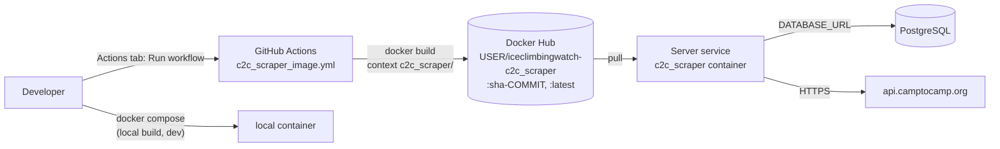

# CI/CD pipeline: camptocamp scraper

This page covers how the camptocamp scraper ([c2c_scraper.md](c2c_scraper.md)) is built, published and run. The daily weather pipeline (`weather/`, [update_ice_weather_db.yml](../.github/workflows/update_ice_weather_db.yml)) is a separate workflow and is not covered here.

**In short:** a **manually triggered** GitHub Actions workflow builds the scraper's Docker image from [c2c_scraper/](../c2c_scraper/) and pushes it to Docker Hub as `<DOCKERHUB_USERNAME>/iceclimbingwatch-c2c_scraper`. A service on the production server runs that published image against PostgreSQL. [c2c_scraper/docker-compose.yml](../c2c_scraper/docker-compose.yml) is for local development and builds from source. There are no automated tests or lint steps, and the workflow has no automatic trigger.



---

## 1. Build and publish (GitHub Actions)

Workflow file: [.github/workflows/c2c_scraper_image.yml](../.github/workflows/c2c_scraper_image.yml)

### Trigger

The workflow runs on `workflow_dispatch` only, which means a manual run from the GitHub **Actions** tab or `gh workflow run`. It takes two inputs:

| Input | Type | Default | Meaning |
|---|---|---|---|
| `image` | choice: `all`, `c2c_scraper` | `all` | Which matrix image to build. Matrix entries that are not selected skip every step and report success. |
| `tag_latest` | boolean | `false` | Also push the `:latest` tag |

Example:

```bash
gh workflow run c2c_scraper_image.yml --ref main -f image=c2c_scraper -f tag_latest=true
```

The workflow builds whatever branch or ref you pick in the dispatch form, so it is not limited to `main`. A `push` trigger on `main` is present but commented out.

### Job: `build-and-push`

The job runs on `ubuntu-latest` with a matrix whose single entry is `c2c_scraper` (context `c2c_scraper`, file `c2c_scraper/Dockerfile`). `fail-fast: false` is set, so more images can be added as matrix entries later.

Every action is pinned to a full commit SHA, with the release tag in a trailing comment (for example `actions/checkout@11d5960… # v4.4.0`). To upgrade an action, replace both the SHA and the comment. Dependabot or Renovate can do this automatically if they are enabled later.

| Step | What it does |
|---|---|
| Decide whether this matrix entry should run | Computes `run=true/false` from the event and the `image` input. Every later step has `if: steps.select.outputs.run == 'true'`. |
| Checkout | `actions/checkout` v4.4.0 |
| Set up Docker Buildx | `docker/setup-buildx-action` v3.12.0 |
| Login to Docker Hub | `docker/login-action` v3.7.0, using secrets `DOCKERHUB_USERNAME` and `DOCKERHUB_TOKEN` |
| Compute image name | `<DOCKERHUB_USERNAME>/iceclimbingwatch-c2c_scraper` (prefix from `env.IMAGE_NAMESPACE`; Docker Hub names must be lowercase) |
| Determine whether to tag `:latest` | `true` on a push to `main` (currently unreachable) or when `tag_latest` is ticked |
| Docker metadata | `docker/metadata-action` v5.10.0 produces tags and OCI labels |
| Build and push | `docker/build-push-action` v6.19.2, `push: true`, layer cache stored in the GitHub Actions cache (`type=gha`, `mode=max`, `scope=c2c_scraper`) |

### Tags produced

- `sha-<full 40-char commit SHA>`: always pushed.
- `latest`: pushed only when `tag_latest` is ticked.

There are no semver or branch tags.

### Required repository secrets

| Secret | Purpose |
|---|---|
| `DOCKERHUB_USERNAME` | Docker Hub login, also used as the image's account prefix |
| `DOCKERHUB_TOKEN` | Docker Hub access token with push rights |

They are separate from `FRONTEND_REPO_TOKEN`, which only the weather workflow uses.

---

## 2. The image

Dockerfile: [c2c_scraper/Dockerfile](../c2c_scraper/Dockerfile). The build context is the `c2c_scraper/` folder only, so the weather pipeline, its database and the docs never end up in the image.

1. Base image: `python:3.13.9`.
2. `COPY requirements.txt` then `pip install`, kept as a separate layer for caching. [requirements.txt](../c2c_scraper/requirements.txt) holds only the scraper's dependencies (`requests`, `SQLAlchemy`, `alembic`, `psycopg`, `pyproj`, `tqdm` and their pinned transitive dependencies).
3. `COPY . .`, filtered by [c2c_scraper/.dockerignore](../c2c_scraper/.dockerignore). The filter drops `.env*` files except `.env.example` (so secrets never end up in an image, including local builds), caches, virtualenvs, `*.db`, logs and the Docker and compose files.
4. `ENTRYPOINT ["python", "main.py"]`. The container's command (`init` or `update`) becomes the mode argument.

Runtime configuration comes from environment variables only (see [c2c_scraper.md §1](c2c_scraper.md#1-running-it)). The template is [c2c_scraper/.env.example](../c2c_scraper/.env.example). With `LOG_TO_FILE=1`, log files go to `LOG_DIR` (for example a `/logs` volume).

---

## 3. Running and deploying

### Production

A service on the server runs the image **published by CI**:

```bash
docker run --rm --env-file .env.runtime <dockerhub-user>/iceclimbingwatch-c2c_scraper:latest update
```

Releasing therefore means running the workflow with `tag_latest` ticked, or deploying a specific `sha-<commit>` tag. Configuring the service and scheduling the periodic `update` runs are done on the server and are not stored in this repo. The very first run against an empty database must be `init`: `update` refuses to run when the `outings` table is empty.

Every run (`init` or `update`) first applies the pending Alembic migrations that ship in the image ([c2c_scraper.md §6](c2c_scraper.md#6-data-written)). Deploying an image with a new migration therefore migrates the production database on its next run, before scraping. A failed migration is rolled back, and the run then stops with `app.crash`.

### Database migrations

Any change to [c2c/schema.py](../c2c_scraper/c2c/schema.py) needs a migration in [c2c/migrations/versions/](../c2c_scraper/c2c/migrations/versions/). To create one, run against a local database that is at the latest revision:

```bash
cd c2c_scraper
export DATABASE_URL=postgresql+psycopg://...   # local database, not production
alembic upgrade head
alembic revision --autogenerate -m "describe the change"   # then review the generated file
alembic upgrade head
alembic check   # "No new upgrade operations detected": models and migrations agree
```

Autogenerate does not detect everything (data fixes, renames, `USING` casts), so review the generated file and add those by hand, as in `0002_unique_country_dates.py`. Name the file `<revision>_<slug>.py` (the `file_template` in [alembic.ini](../c2c_scraper/alembic.ini)).

### Local development

[c2c_scraper/docker-compose.yml](../c2c_scraper/docker-compose.yml) builds the image from the local source:

```bash
cd c2c_scraper
docker compose run --rm c2c_scraper_init   # one-off: migrate (creates the schema) + full route scrape
docker compose run --rm c2c_scraper        # incremental update
```

| Service | Command | Notes |
|---|---|---|
| `c2c_scraper_init` | `init` | Builds from `c2c_scraper/Dockerfile` |
| `c2c_scraper` | `update` | Same image, incremental mode |

Both services read `env_file: .env.runtime` (in `c2c_scraper/`), which is gitignored and must be created from `.env.example`.

---

### TODO

- Add a test and lint job that the build job depends on (`needs:`).
- One main development work has been done: Re-enable `push` on `main` (optionally with `paths: [c2c_scraper/**]`), so `main` publishes `:latest` automatically.
